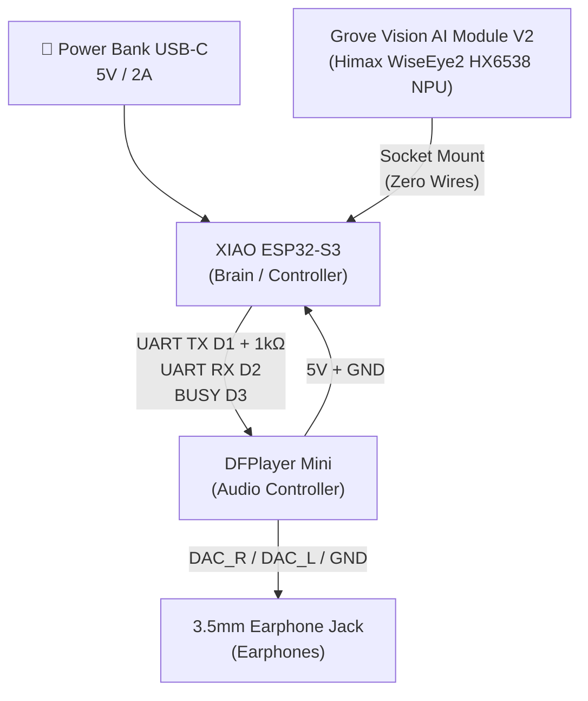
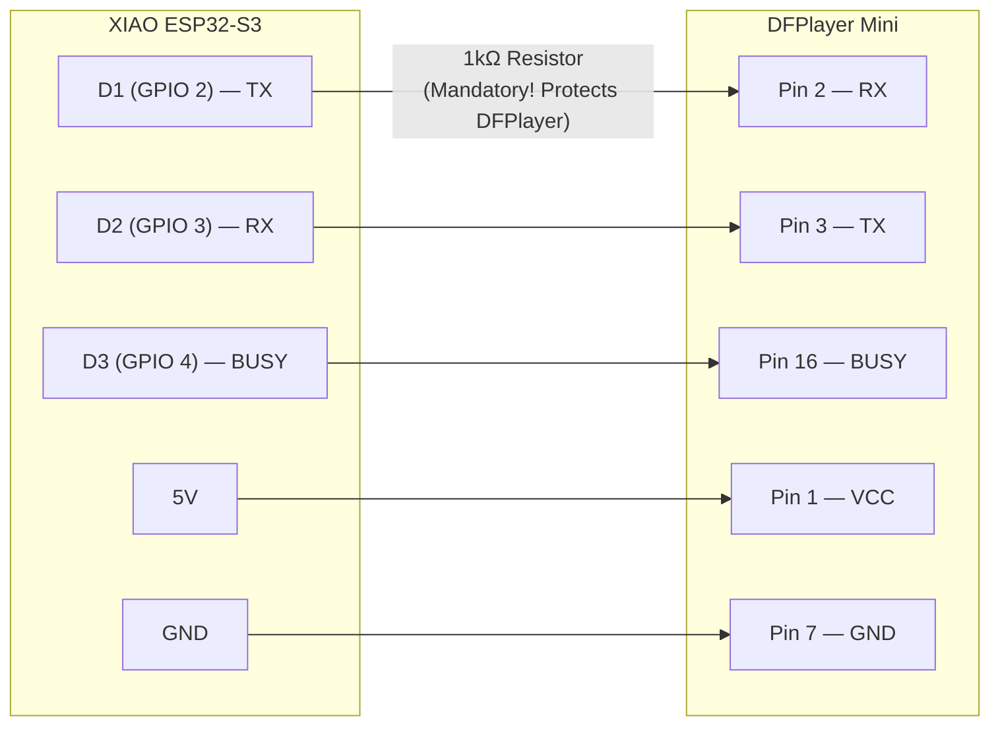
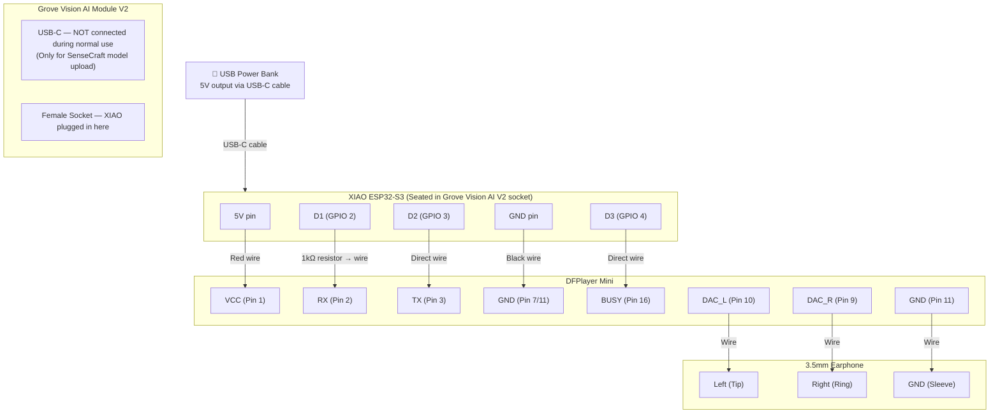

# Drishti Assistive Vision System — Complete Circuit & Wiring Reference

> [!IMPORTANT]
> This is the **definitive, fault-free wiring guide** for all hardware in the Drishti project. Follow pin numbers **exactly** as listed — no substitutions unless noted.

---

## System Architecture Overview

---

## 1. XIAO ESP32-S3 Pin Map Reference

| XIAO Label | GPIO | Used For |
| :--- | :---: | :--- |
| D1 | 2 | DFPlayer TX (Audio command output) |
| D2 | 3 | DFPlayer RX (Feedback from DFPlayer) |
| D3 | 4 | DFPlayer BUSY (HIGH = idle, LOW = playing) |
| D4 | 5 | I2C SDA → Grove Vision AI V2 *(via socket, no wire)* |
| D5 | 6 | I2C SCL → Grove Vision AI V2 *(via socket, no wire)* |
| D6 | 43 | UART TX → Grove Vision AI V2 *(via socket, no wire)* |
| D7 | 44 | UART RX ← Grove Vision AI V2 *(via socket, no wire)* |
| 5V | — | Output 5V to DFPlayer VCC |
| 3.3V | — | **DO NOT use for DFPlayer** |
| GND | — | Common Ground |

---

## 2. Connection 1: Grove Vision AI Module V2 ↔ XIAO ESP32-S3

> [!IMPORTANT]
> **ZERO WIRES REQUIRED.** The XIAO ESP32-S3 plugs physically into the dual 7-pin female header socket on top of the Grove Vision AI Module V2. This is the **only correct way** to connect them.

### How to Mount Correctly:
1. Hold the Grove Vision AI Module V2 with its USB-C port facing **left**.
2. Hold the XIAO ESP32-S3 with its USB-C port also facing **left**.
3. Gently press the XIAO into the socket — both USB-C ports must face the **SAME direction**.
4. No wires, no jumpers — the socket makes all connections internally.

### What the Socket Connects Internally:

| Grove Vision AI V2 Internal | ↔ | XIAO ESP32-S3 |
| :--- | :---: | :--- |
| I2C SDA | ↔ | D4 (GPIO 5) |
| I2C SCL | ↔ | D5 (GPIO 6) |
| UART TX (Himax → XIAO) | ↔ | D7 (GPIO 44, RX) |
| UART RX (XIAO → Himax) | ↔ | D6 (GPIO 43, TX) |
| 3.3V Power | ↔ | 3.3V |
| GND | ↔ | GND |

---

## 3. Connection 2: DFPlayer Mini ↔ XIAO ESP32-S3

### Exact DFPlayer Mini Pin Reference:
DFPlayer Mini is a small rectangular board with pins on both sides. The pins are numbered from the top-left going down.

| DFPlayer Mini Pin | Number | Connect To |
| :--- | :---: | :--- |
| VCC | 1 | XIAO **5V** |
| RX | 2 | XIAO D1 (GPIO 2) **through 1kΩ resistor** |
| TX | 3 | XIAO D2 (GPIO 3) — direct wire |
| GND | 7 | XIAO **GND** |
| BUSY | 16 | XIAO D3 (GPIO 4) — direct wire |
| SPK_1 | 6 | *Leave unconnected (not using speaker)* |
| SPK_2 | 8 | *Leave unconnected (not using speaker)* |
| DAC_R | 9 | Earphone Right (tip of 3.5mm jack) |
| DAC_L | 10 | Earphone Left (ring of 3.5mm jack) |
| GND | 11 | Earphone Sleeve (GND of 3.5mm jack) |

> [!CAUTION]
> The **1kΩ resistor on the RX line is MANDATORY**. Without it, the 3.3V logic from the XIAO ESP32-S3 will damage the DFPlayer Mini's UART input over time. Use a standard ¼W resistor — it does not affect audio quality.

---

## 4. Connection 3: Earphone Jack ↔ DFPlayer Mini

The 3.5mm stereo earphone jack has 4 contact points (TRRS) or 3 (TRS):

| Earphone Jack Contact | Connect To | DFPlayer Pin |
| :--- | :--- | :---: |
| Tip (Left audio) | DAC_L | Pin 10 |
| Ring 1 (Right audio) | DAC_R | Pin 9 |
| Sleeve (Ground) | GND | Pin 11 |

> [!NOTE]
> You can use **any standard 3.5mm earphones** — wired earphones with a 3.5mm jack. The DFPlayer Mini has a built-in DAC with headphone amplifier, so the audio output is clean and loud enough at default volume 24/30.

---

## 5. Full System Wiring Checklist

---

## 6. Power Supply — Exact Specifications

| Power Source | Specification | How to Connect |
| :--- | :--- | :--- |
| **USB Power Bank** | 5V, minimum 1A (2A recommended) | USB-C cable → XIAO ESP32-S3 USB-C port |
| **XIAO 5V rail** | 5V passthrough from USB | Supplies DFPlayer Mini VCC |
| **Grove Vision AI V2** | Powered by XIAO socket (3.3V) | No separate supply needed |
| **DFPlayer Mini** | 3.3V–5V (use XIAO's 5V) | Already covered above |

### Why a 2A Power Bank?
- XIAO ESP32-S3 at full load: ~240mA
- Grove Vision AI Module V2 inference: ~150mA peak
- DFPlayer Mini playing audio: ~50mA
- **Total peak draw: ~440mA**
- A 1A power bank works, but 2A gives headroom to prevent brownout during peak AI inference.

> [!CAUTION]
> Do **NOT** use a laptop USB port or phone charger directly in a portable scenario. A dedicated **USB power bank with 2A output** is the right supply for field use.

---

## 7. Micro SD Card (for DFPlayer Mini)

The DFPlayer Mini reads audio files from a **Micro SD card**. This is critical — without it, no audio plays.

| Requirement | Detail |
| :--- | :--- |
| **Card Capacity** | 1GB to 32GB (FAT32 formatted) |
| **Folder Name** | Must be named exactly `/MP3/` on root |
| **File Names** | `0001.mp3`, `0006.mp3`, `0008.mp3`, `0013.mp3`, `0018.mp3`, `0019.mp3`, `0023.mp3`, `0026.mp3` |
| **Format** | MP3, 128kbps or lower, 44.1kHz |

Your SD card with the Drishti voice files should be inserted into the DFPlayer Mini's Micro SD card slot before powering on.

---

## 8. Should You Include the Ultrasonic Sensor?

### Honest Assessment for Your Submission Deadline

> [!TIP]
> **For your submission: SKIP the ultrasonic sensor.** Here is exactly why:

| | With Ultrasonic Sensor | Without Ultrasonic Sensor |
| :--- | :--- | :--- |
| **Your project currently** | ❌ Not wired | ✅ Fully working |
| **Code impact** | Needs `ENABLE_HAPTIC_SAFETY true` + recompile | Zero changes needed |
| **Extra hardware** | HC-SR04 + NPN transistor + vibration motor + resistors | Nothing extra |
| **Extra wiring** | 4 more wires + voltage divider on ECHO pin | Nothing |
| **Risk of failure** | Medium (voltage mismatch can damage GPIO) | None |
| **Core demo value** | Adds close-range buzz | Vision AI + audio alert fully demonstrates the concept |

### What the Ultrasonic Sensor Would Add:
- Detects **very close obstacles** (< 80cm) that the camera may miss at extreme angles.
- Vibrates the **stick handle** without needing audio — silent haptic feedback for quieter environments.

### What the Vision AI Already Handles:
- The **camera sees objects at 1–4 meters** with class-specific names (*"Person ahead"*, *"Chair ahead"*) — far more information than a simple distance buzz.
- The camera runs at **30 FPS, 3ms inference** — it is already extremely fast.

### Final Recommendation:
✅ **For submission tomorrow — skip the ultrasonic sensor entirely.** The Vision AI camera + DFPlayer Mini earphone audio is the complete, impressive, working demonstration. The ultrasonic sensor is a nice future enhancement but **adds complexity and risk with no visible benefit on the demo day**.